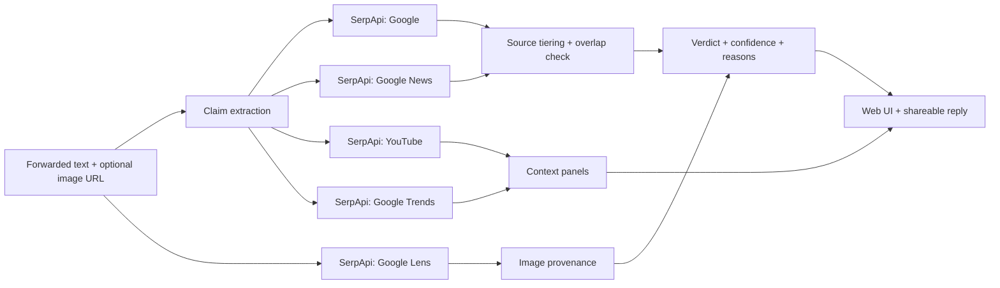

# ForwardCheck

**Paste a WhatsApp forward. Get a verdict backed by live search evidence, plus a polite reply you can send back to the family group.**

Built for the [SerpApi India Hackathon 2026](https://serpapi.com/) · Python · FastAPI · SerpApi (Google, Google News, Google Lens, YouTube, Google Trends)

> **Repo:** https://github.com/Ojash-creator/ForwardCheck  

---

## Why

Misinformation spreads fastest in family WhatsApp groups, where nobody wants to be the person who says "this is fake" without proof. ForwardCheck does the searching for you, shows *why* it reached a verdict, and drafts a short, kind reply with sources attached. It handles English, Hindi and Hinglish.

## What it does

| Step | What happens | SerpApi engine |
|---|---|---|
| 1. Claim extraction | Pulls the checkable claim(s) out of the forward and builds neutral search queries. Uses Claude if `ANTHROPIC_API_KEY` is set, otherwise a rule-based extractor. | none |
| 2. Fact-checkers and web | Searches `"<claim> fact check"` and classifies each result by source tier (fact-checker, official, news, other). | `google` |
| 3. News coverage | Looks for credible outlets reporting or debunking the claim. | `google_news` |
| 4. Image provenance | Reverse-searches the image and flags fact-check pages and earlier-year matches ("possibly recycled"). | `google_lens` |
| 5. Spread | Finds videos spreading or debunking it. | `youtube` |
| 6. Timing | Shows search interest over the last 12 months (when the claim started to spike). | `google_trends` |
| 7. Verdict | Rule-based scoring → **Likely false / Misleading / Unverified / Supported**, with confidence, reasons, a source-disagreement view and a shareable reply. | none |

Without SerpApi there is nothing to score: every verdict is computed from live search results.



## Quick start

Requires Python 3.10+.

```bash
git clone https://github.com/Ojash-creator/ForwardCheck.git
cd forwardcheck
python -m venv .venv && source .venv/bin/activate      # Windows: .venv\Scripts\activate
pip install -r requirements.txt

cp .env.example .env          # Windows: copy .env.example .env
# open .env and paste your key:  SERPAPI_API_KEY=...   (free key: https://serpapi.com/manage-api-key)

uvicorn app.main:app --reload
```

Open http://127.0.0.1:8000.

**No key yet?** The app still runs. Click an example chip and tick "Use saved sample data" to see the full pipeline with no credits. (The bundled samples are synthetic; see [Sample data](#sample-data).)

## Using it

1. Paste the forwarded text (and optionally a **public** image URL: Google Lens fetches it).
2. Click **Check this forward**.
3. Read the verdict and the reasons. Open the sources. Copy the reply or open it straight in WhatsApp.

### Credit usage

A full check costs up to **5 SerpApi searches** (Google ×1–2, News, YouTube, Trends, plus Lens if you add an image). Results are cached on disk for 24 h, and `MAX_CREDITS_PER_SESSION` (default 120) stops a runaway loop from spending your 250 free monthly credits. Untick YouTube/Trends in the UI to spend 2–3 per check.

## Configuration (`.env`)

| Variable | Default | Purpose |
|---|---|---|
| `SERPAPI_API_KEY` | none | Required for live checks |
| `ANTHROPIC_API_KEY` | none | Optional, better Hindi/Hinglish claim extraction |
| `LLM_MODEL` | `claude-sonnet-5-5` | Model used for claim extraction |
| `DEMO_MODE` | `auto` | `true` = never call SerpApi |
| `MAX_CREDITS_PER_SESSION` | `120` | Hard cap on searches per server run |
| `CACHE_DIR` | `.cache` | On-disk response cache |

## How the verdict works

Deliberately simple and explainable (see `app/scoring.py`, `app/sources.py`):

- Each result is tiered: **fact-checker** (Alt News, BOOM, Snopes, …), **official** (`.gov.in`, `.nic.in`, WHO, …), **news**, or **other**.
- A result only counts if it shares enough key words with the claim.
- Debunk weight: fact-checker + debunk language **3**, news/official + debunk language **2**, fact-checker with unclear rating **1**.
- Support weight: official **2**, news **1.5**, fact-checker rating the claim true **2**.
- Each domain counts once, so syndicated copies cannot inflate a score.
- Image matches add up to **3** debunk points if they appear on fact-check pages or mention an earlier year.
- Thresholds: debunk ≥ 3 → *Likely false*; ≥ 1.5 → *Misleading*; support ≥ 3 → *Supported*; credible sources that split → *Unverified* with both sides shown; anything else → *Unverified*.

Edit the source lists in `app/sources.py` to tune credibility.

## API

| Endpoint | Description |
|---|---|
| `GET /api/health` | Mode, version, credits used |
| `GET /api/examples` | Built-in examples |
| `POST /api/check` | `{ "text": "...", "image_url": "...", "use_trends": true, "use_youtube": true }` |

## Project layout

```
app/
  main.py       FastAPI routes
  pipeline.py   orchestrates the SerpApi calls
  serp.py       SerpApi client (cache, credit cap, key scrubbing) + demo client
  claims.py     claim extraction (Claude or rule-based)
  scoring.py    tiers, weights, verdict, reply builder
  sources.py    editable credibility lists
static/index.html   single-page UI
demo/               sample fixtures (replayed without credits)
scripts/            record_demo.py, check_placeholders.py
tests/              pytest suite (no network needed)
docs/               submission text, demo script, GitHub guide
```

## Tests

```bash
pip install -r requirements-dev.txt
pytest
```

All tests run offline.

## Sample data

The three bundled examples in `demo/` are **synthetic**: hand-written in SerpApi's response format, using fictional `*.example` domains. They exist so anyone can try the app without a key and are labelled as sample data in the UI. To replay **real** results, record them with your key:

```bash
python -m scripts.record_demo --id my-hoax --title "My hoax" --text "<paste forward>" [--image-url https://...]
```

## Limitations (honest ones)

- It aggregates what search results say; it is **not** a substitute for professional fact-checkers. Always open the sources.
- Google Lens needs a **public image URL**; uploading a local screenshot is not supported yet.
- Debunk detection is keyword based, so sarcasm or unusual phrasing can be missed.
- "Possibly recycled" is a heuristic: it flags an earlier year in matching pages, which can be coincidental.
- Brand-new hoaxes may have no coverage yet; the app then says *Unverified* rather than guessing.
- Dates from Google News/Trends come as display strings, so there is no exact first-seen timestamp.

## Roadmap

Direct screenshot upload (host + Lens), WhatsApp bot via Twilio, more regional languages, browser extension.

## AI disclosure

Built with assistance from Claude (Anthropic) for code generation and documentation. The author reviewed and is responsible for every component. Claude is also an optional runtime dependency for claim extraction.

## License

MIT, see [LICENSE](LICENSE).
